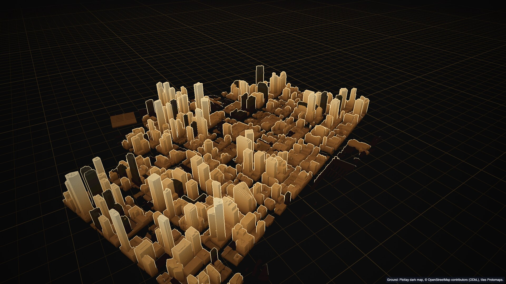
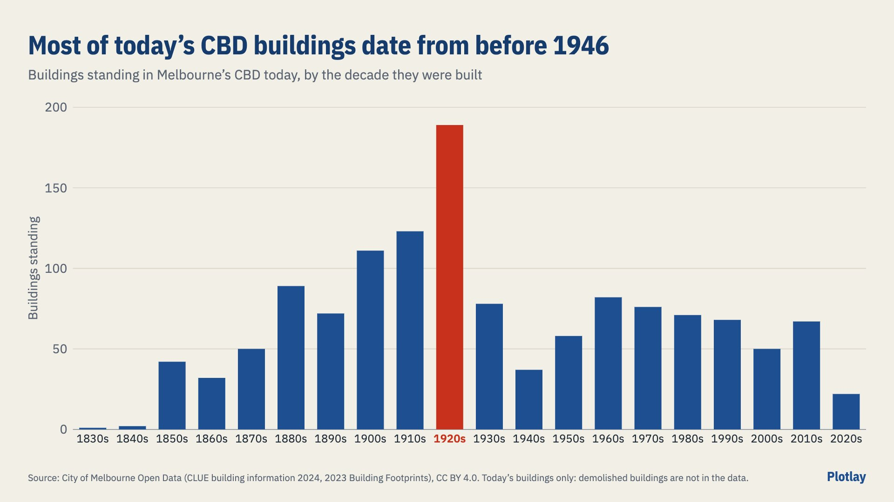

# How Melbourne's city centre was built, year by year

The buildings standing in the City of Melbourne's CBD today, from the council's 2023 building footprints, each given the construction year from its Census of Land Use and Employment (CLUE) record, census year 2024. **Live version, with an interactive map and the 3D animation:** [getplotlay.com/showcase/melbourne-built-by-year](https://www.getplotlay.com/showcase/melbourne-built-by-year/)



The footprints show **1,548 buildings** in the CBD; the census gives a construction year for **1,320** of them. **62% of those were built before 1946, but they hold only about 18% of the floor space.** The 184 built since 1991, many of them apartment towers, hold about 48%.

The census records each building's year as a point with no outline; the footprints have outlines and heights but no year. They were joined in [Plotlay](https://www.getplotlay.com), raised in 3D at their own heights and grown by year; the charts, renders and animation were made in Plotlay too.

[](https://app.plotlay.io/?example=melbourne-built-by-year&as=client)

## What the data says

| Built | Buildings standing today | Share of dated buildings | Share of floor space (estimate) |
|---|---|---|---|
| 1837 to 1860 | 58 | 4.4% | 1.3% |
| 1861 to 1900 | 248 | 18.8% | 4.8% |
| 1901 to 1945 | 518 | 39.2% | 12.3% |
| 1946 to 1990 | 312 | 23.6% | 33.3% |
| 1991 to 2024 | 184 | 13.9% | 48.3% |



### Read it carefully

- **Today's buildings, not the city as it was.** Demolished buildings are not in the data, so a year shows the buildings standing now that were built by then.
- **Years are approximate.** The council's construction year is often a round year and can be the year of later major works: 28% of dated buildings carry a year ending in 0, or 1901.
- **14.7% have no year** (228 of 1,548): 196 have no census record inside them and 32 a record with a blank year. They are mostly small (median 10 m tall against 18.5 m).
- **One record per building**: where several properties share a building, the one with the most floors gives the year.
- **Floor space is an estimate**: each footprint part's area times its height over 3.5 m a floor, to compare eras only.

## How it was made with Plotlay

1. **The footprints**: the 4,442 parts of the CBD's 1,548 structures as a data layer, each with its height over the structure's base and the base it stands on.
2. **The join**: each structure takes the CLUE record whose point is inside it (1,443), or the nearest within 8 m (66); 33 records match no building.
3. **Colour** by the era built and **Show in 3D** at each part's height.
4. **Grow by year** on the year column: the map shows buildings as the slider passes their year; the 3D view raises them under a year counter. No year: shown faint.
5. **The Sepia look** in 3D and **Export, Video of the years** for the animation.

## What's here

| Folder | What |
|---|---|
| [`data/geometry/`](data/geometry) | `parts.geojson`: every footprint part with `height_m`, `base_m`, `year`, `floors`, `match`, address and use |
| [`data/clue/`](data/clue) | `buildings_cbd_2024.csv`: the CLUE building records for the CBD |
| [`data/tables/`](data/tables) | `buildings.csv` (one row per structure), `decades.csv`, `eras.csv` |
| [`python/`](python) | A narrated notebook that does the join again: [`built_by_year.ipynb`](python/built_by_year.ipynb) |
| [`powerbi/`](powerbi) | A Power BI Project (`.pbip`). Start with [`powerbi/OPEN-ME.md`](powerbi/OPEN-ME.md) |
| [`visuals/`](visuals) | The renders, charts and animation |

### Run the notebook

```
python3 -m venv .venv
.venv/bin/pip install -r python/requirements.txt
cd python && ../.venv/bin/jupyter lab built_by_year.ipynb
```

## Sources and licences

- **Code** (notebook, Power BI project): MIT, see [`LICENSE`](LICENSE).
- **Our data** (the year joined to the footprints, the tables, the pictures): CC BY 4.0, see [`LICENSE-DATA`](LICENSE-DATA). Credit "Plotlay (getplotlay.com)" and the sources below.
- Building information (CLUE, census year 2024), 2023 Building Footprints and Small Areas for CLUE: City of Melbourne Open Data, data.melbourne.vic.gov.au, CC BY 4.0.
- Base map in the app: © Commonwealth of Australia (Geoscience Australia), CC BY 4.0.

This is independent work using open data, not endorsed by the City of Melbourne. Full credits are in [`NOTICE`](NOTICE).
